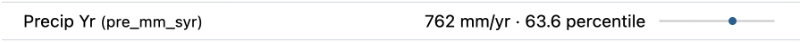
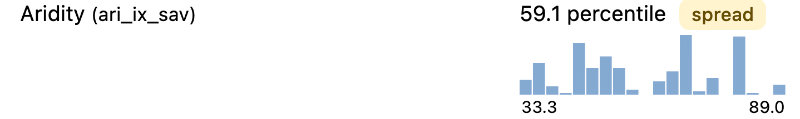
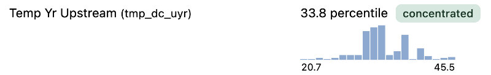
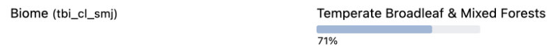
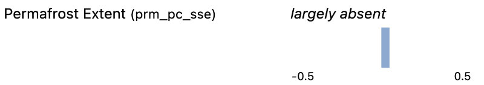
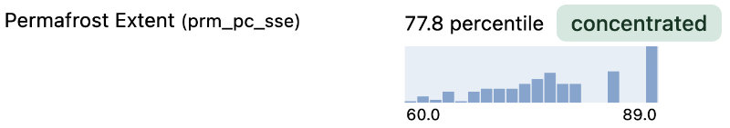
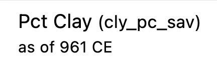
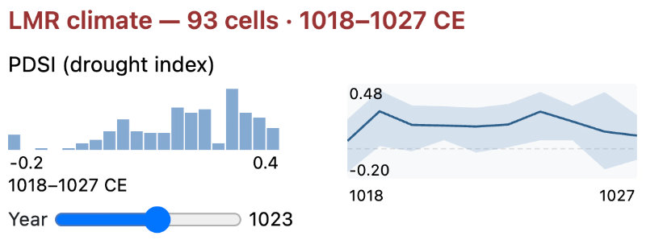
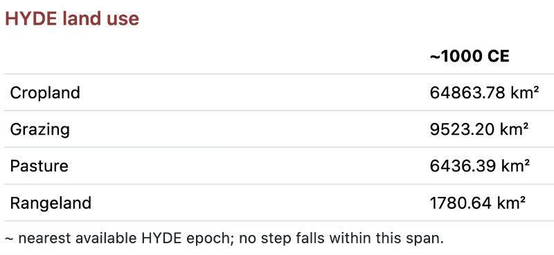
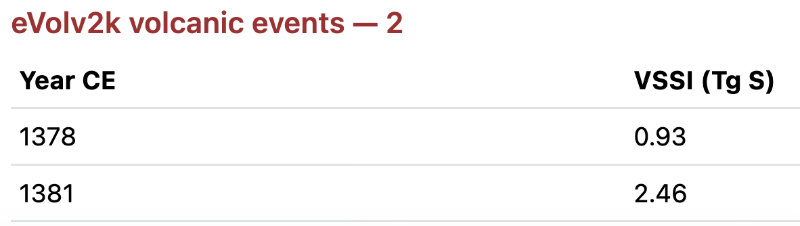

# Reading a signature

The Signature tab presents a place's environmental variables in accordions, one per band. This page
explains how to read what's displayed — the numbers, badges, bars, and small charts. It does not
explain how to operate the Sandbox (see [Overview](overview.md)) or what individual variables mean
(see the [Codebook](../codebook.md)).

## One basin or many

The single thing that determines how a signature looks is **how many basins the query covers**.

If you ask about a settlement without a buffer, the answer comes from one basin. Every variable has
exactly one value, and the display shows that value and where it sits globally.

If you add a buffer, or ask about a polity, the answer comes from a set of basins — sometimes a
handful, sometimes hundreds. There is no single value any more. What EDOPS shows instead is a
summary of the distribution across those basins, plus a chart of the distribution itself.

This is a consequence of the scope you choose, not of what kind of place you asked
about. A settlement with a wide buffer produces the same kind of display as a small polity.

## Numeric variables

### One basin

You get the measured value, its global percentile, and a marker showing that percentile on a line:

> Precip Yr — `762 mm/yr · 63.6 percentile`

The percentile is global. Each basin's raw value is ranked against every other basin worldwide at
the resolution level you queried — not against the region, not against the scope. A reading
of 63.6 means this basin is wetter than 63.6% of all basins on Earth.

### Many basins

You get an area-weighted percentile, a **concentrated**, **spread** or **split** badge, and a histogram of how
the constituent basins are distributed:

> Aridity — `59.1 percentile` · *spread*

> Temp Yr Upstream — `33.8 percentile` · *concentrated*

The headline percentile is the area-weighted mean of each contributing basin's own percentile —
larger basins pull it further. The two numbers flanking the histogram are the lowest and the highest
percentile among the contributing basins, so they mark the full extent of the distribution. (A few
variables are drawn as a bar rather than a histogram; its end labels are the 10th and 90th
percentiles, the middle 80%.)

The badge summarises how much the basins agree. EDOPS looks for the stretch of the percentile
scale, 30 points wide, that holds the most of the area; the pale band behind the histogram shows
where it found it. If that stretch holds at least 65% of the area, the badge is **concentrated** —
most of the area sits at much the same position, and the area is environmentally consistent in this
respect. If not, it is **spread** — the area contains real internal variation, and the headline
number is an average over genuinely different places. **Split** appears when at least half the area
has exactly the same score (usually zero, where the variable is absent) and a real separate group,
at least a tenth of the area, lies elsewhere on the scale. The 65% cutoff is provisional. With fewer
than five basins no badge is shown, because the measure isn't reliable for so few.

All three badges are informative. *Spread* is not a warning; for a large polity it is often the expected
and interesting result.

### Reading the histogram

The shape tells you how many basins are in the query. A handful of tall isolated bars means a small
set — a buffered settlement, or a compact polity. A smooth mound means a large one. In a small set,
individual bars are individual basins and you can see the clustering directly; in a large set the
distribution's shape is what matters.

Note that a wide gap between the histogram's end labels and a *spread* badge are not the same
thing. The end labels show where the extreme basins fall; the badge asks whether most of the area
sits close together, so one long thin tail can leave the badge at *concentrated*.

## Categorical variables

Categorical variables — biome, lithology, land cover, wetland class — have no percentile. They show
the most common class across the query area and the share of the area holding that class:

> Biome — `Temperate Broadleaf & Mixed Forests` · 71%

For a single basin this is always 100%: one basin has one majority class. For a set, the percentage
is what matters. A share of 97% means the area is essentially uniform. A share of 44% means the
named class is merely the largest of several, and more than half the area is something else — the
label alone would be misleading, and the bar is what stops you being misled.

Only the leading class is shown, not the full mixture.

## Extremes and single-basin selections

A few variables are not averaged at all. Where a variable represents a maximum or a defining
feature, the display reports the value from the single basin carrying it, along with that basin's
identifier, and no chart. These read as one value even for a large query, because they describe one
basin's contribution rather than a summary of all of them.

## When a value is missing

An em-dash (`—`) appears only when a value is missing for a reason the interface doesn't recognise.
It never means zero; zero is a real measurement and displays as `0`. When EDOPS knows why there is
no number, it says so, in italics or as a note under the row:

*Not present here* (one basin) or *largely absent* (several basins) means the variable is
essentially absent from the area: karst, permafrost or cropland where there is none. This is not
missing data. The underlying values are zero or near it across at least 90% of the area, and a
percentile isn't a meaningful way to represent that. For several basins the histogram is still
shown, and hovering *largely absent* gives the rule.

*No data* means the source dataset has no value for the basin or basins in the query.

*(Low coverage)*, shown after a category's name, means less than half of the query area has a value
for that variable. The rest is open water, lies beyond the basin data, or has no value in the
source (ice sheets, for example). The category shown is the leading one among the part that does.

"No single percentile: the area has two distinct groups of values," with the histogram still shown,
means the contributing basins split into two different clusters. A single percentile would average
across the split and misrepresent both halves, so none is reported — read the histogram directly.

"River-network measure, not defined for an area" appears for polity queries on the discharge rows
(annual mean, monthly maximum and minimum). They describe a position on the river network, so they
have no value for an area.

## The date stamp

Where a query has a temporal component, each variable label carries a small `as of NNNN CE` note.
This records the year the query resolved to. For variables in the persistence bands the value itself
is contemporary — the stamp tells you the period the query was about, not the period the measurement
comes from. How far a contemporary measurement can be carried back is what the bands encode; see
[Premises and commitments](../design/commitments.md).

## Band T is different

Band T does not use any of the above. Its variables come from datasets that are genuinely indexed to
time, and each source has its own display:

- **LMR** — annual series charts for temperature, precipitation, and drought index, with a year
  slider and a small distribution summary. The header reports how many LMR grid cells intersect the
  query area and the year range covered.

    

- **HYDE** — a table of land-use extents at the selected year.

    

- **eVolv2k** — a list of volcanic events in the period with their sulfur injection values.

    

None of these carry percentiles, badges, or global rankings. They are values in time, not positions
in a global distribution, and they are read accordingly.

The count in the Band T accordion header counts values, not variables — it will be much larger than
the counts on the other bands.